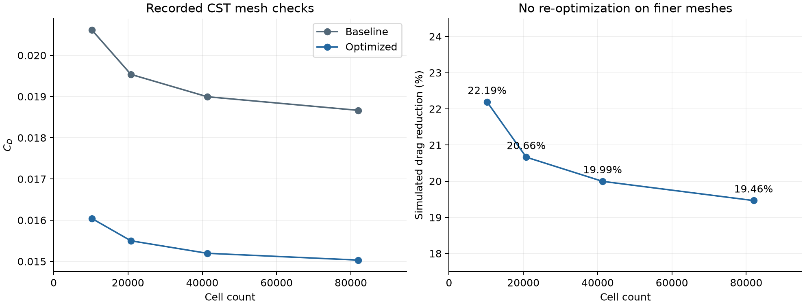
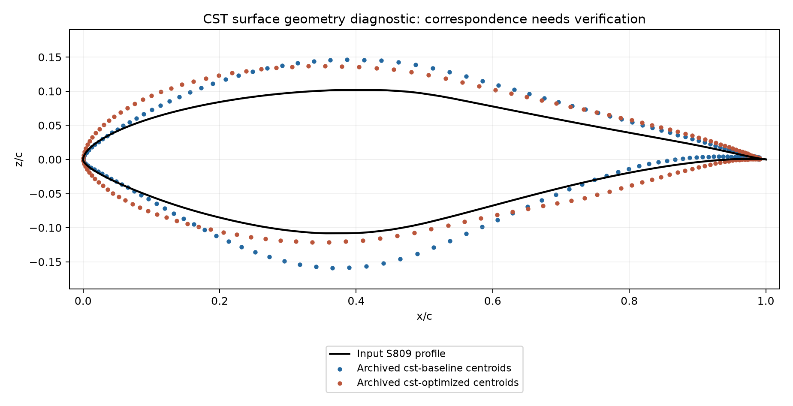
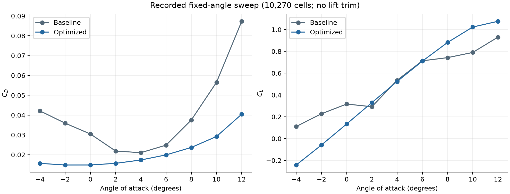

# NREL S809 Airfoil: Adjoint-Based Shape Optimization

**Two computational aerodynamics case studies using DAFoam, OpenFOAM and Python.**

**Author:** [Mineth Lohiru Ariyarathna](https://github.com/broccolize) · Aerospace Engineering undergraduate, Northwestern Polytechnical University

I investigated drag minimization near a target lift coefficient of **CL = 0.4** using two separate geometry parameterizations: free-form deformation (FFD) and class-shape transformation (CST). The CST study also includes mesh-sensitivity checks, a fixed-angle sweep, and comparisons of airfoil shape and surface pressure.

This repository presents the case inputs, scripts, recorded solver evidence, and a lightweight reproducible analysis. **All aerodynamic results are simulated.** The two cases use different conditions and software environments; their drag reductions do not establish that one parameterization is superior.

> **Geometry verification pending for CST:** the archived baseline surface used in the pressure/shape plot has a larger vertical coordinate envelope than the supplied S809 profile. The cause has not been established. The CST aerodynamic coefficients below are recorded outputs of that workflow; their interpretation as a verified S809 geometry needs this discrepancy resolved. See the [geometry diagnostic](data/surface-geometry-audit.json) and [audit notes](docs/results-audit.md#cst-geometry-correspondence-needs-verification).



## My contribution

I set up the cases, adapted and modified the case scripts, generated meshes, ran the simulations and optimizations, analysed the results, and prepared the case-study report. My work included:

- Configuring the S809 FFD case at **Re = 500,000**, including the airfoil profiles, FFD control lattice, target lift and geometric constraints.
- Setting up the **Re = 2,000,000** CST case, using six coefficients per surface and angle of attack as design variables.
- Evaluating the fixed baseline and optimized CST shapes on finer meshes, and running a nine-angle sweep for each shape.
- Examining optimization histories, drag/lift coefficients, airfoil geometry and pressure distributions, while documenting differences between the cases and unresolved convergence issues.

These are case-study contributions built on existing software and tutorial patterns. I did not develop the DAFoam solver, OpenFOAM, OpenMDAO, pyGeo or the MDO Agent Deck framework. See [attribution and licensing](NOTICE.md). The later repository organization and the log-audit/staging utilities in `tools/` were prepared with AI assistance; they are separate from the original simulation work.

## Cases and recorded results

Both cases use steady incompressible `DASimpleFoam`, the Spalart–Allmaras model and IPOPT. The saved IPOPT logs report **“Optimal Solution Found”** for both optimization runs.

| Quantity | Case A: FFD | Case B: CST |
|---|---:|---:|
| Reynolds number | 500,000 | 2,000,000 |
| Freestream velocity | 7.5 m/s | 30 m/s |
| Optimization mesh | 26,522 cells | 10,270 cells |
| Shape variables + angle of attack | 18 + 1 | 12 + 1 |
| Lift constraint | CL = 0.4 | CL ≥ 0.4 |
| Baseline CD | 0.0165731 | 0.0206158 |
| Optimized CD | 0.0161110 | 0.0160418 |
| **Simulated drag reduction** | **2.79%** | **22.19%** |
| IPOPT major iterations | 24 | 12 |

Numbers are reconstructed from the archived physical solver outputs and matched to the initial/final IPOPT objective states. Lift is close to, rather than numerically identical to, 0.4: the detailed [CSV](data/optimization_summary.csv) includes the actual CL values. CST's optimizer objective uses a scale factor of 10; its raw objective value is not CD. Small differences from the original report's rounded tables are explained in the [results audit](docs/results-audit.md).

### CST mesh-sensitivity checks

The shapes from the 10,270-cell optimization were **not re-optimized** on finer meshes. Each shape was re-evaluated with a lift-trim search near CL = 0.4.

| Cells | Baseline CD | Optimized CD | Simulated reduction |
|---:|---:|---:|---:|
| 10,270 | 0.0206158 | 0.0160418 | 22.19% |
| 20,792 | 0.019537 | 0.015500 | 20.66% |
| 41,340 | 0.018995 | 0.015197 | 19.99% |
| 81,984 | 0.018665 | 0.015032 | **19.46%** |

The recorded drag benefit remains under refinement, but the absolute coefficients still change. This is a **mesh-sensitivity study**, not a formal proof of grid independence or experimental validation. The finest check's optimized CL is 0.399737. See [all coefficients](data/mesh_sensitivity.csv) and [limitations](#limitations).

### Shape, pressure and angle sweep



The [historical shape/pressure plot](results/figures/case-b-shape-and-cp.png) is retained unchanged as a study artifact, with the geometry correspondence issue flagged above. The fixed-angle sweep evaluates each shape at **−4°, −2°, 0°, 2°, 4°, 6°, 8°, 10° and 12°**, without lift trimming at those points.



The baseline lift dip between 0° and 2° is preserved in the data. Its cause is unresolved; under-convergence is a possibility, not an established aerodynamic explanation.

## Reproduce the analysis without a CFD installation

From the repository root, use **Python 3.10 or newer**:

```bash
# Verify included artifacts and reconstruct/check the saved-result tables.
# This uses only the Python standard library and does not modify the tables.
python tools/reproduce_results.py
python tools/check_surface_geometry.py

# Optional: install plotting dependencies and regenerate CSVs and summary plots.
python -m pip install -r requirements-analysis.txt
python tools/reproduce_results.py --write --plots
python tools/check_surface_geometry.py --write --plot
```

This audits the compressed logs, checks optimizer/physical-value consistency and all 18 sweep records, and regenerates the lightweight figures. The separate surface tool reproduces the known geometry discrepancy from the included boundary exports. A successful artifact audit means the saved outputs agree with their evidence; it does not mean the geometry issue is resolved. **Neither tool runs CFD or independently validates the flow solutions.**

## Re-run the CFD cases

Use a compatible Linux/WSL or container solver environment. The recorded environments differ:

| Case | DAFoam | OpenFOAM | Additional requirements |
|---|---|---|---|
| FFD | 4.0.4 | v1812 | MPhys/OpenMDAO, pyGeo, pyHyp, pyOptSparse/IPOPT, MPI |
| CST, mesh checks and sweep | 5.0.0 | v2506 | OpenVSP and the external `mdo_agent_*`/`airfoil_assets` modules, plus the solver stack |

Exact historical container tags and all dependency versions were not captured in the supplied files. The CST workflow needs separately installed MDO Agent Deck components; those components are not bundled here. A fresh end-to-end CFD run has **not** been verified during repository preparation.

First stage a case into a new working directory:

```bash
python tools/stage_case.py case-a-ffd
```

Then follow the case commands in **[CFD reproduction instructions](docs/reproduction.md)**. The staging tool refuses to overwrite existing runs. The original case inputs and archived evidence are kept separate from solver cleanup.

## Repository layout

```text
cases/                  Case inputs and scripts, grouped by study
  case-a-ffd/           FFD optimization at Re = 500,000
  case-b-cst/           CST optimization at Re = 2,000,000
  mesh-check-{20,40,80}k/
  aoa-sweep/
data/                   Reconstructed CSVs, sweep JSON and source manifest
evidence/               Losslessly compressed original logs and IPOPT receipts
results/figures/        Selected source figures and regenerated summary plots
reports/                Original case-study PDF
tools/                  Log audit, plotting and safe run-staging utilities
docs/                   Methodology, reproduction and evidence notes
```

Generated volume meshes, decomposed fields, duplicate plots, cache files, the screen recording and local connection settings are excluded. Two lightweight boundary-surface exports are included for the geometry diagnostic. Original-to-repository filenames and SHA-256 checksums are recorded in [the source manifest](data/source-manifest.json).

## Limitations

- **No controlled FFD-versus-CST comparison:** Reynolds number, mesh, wall treatment, constraint implementation and software versions differ.
- **CST surface correspondence is unresolved:** the saved baseline export does not closely match the input profile; check the geometry/export pipeline before stronger interpretation of its results.
- **Numerical study only:** no wind-tunnel validation, formal grid-convergence index or verified gradient-check result is included.
- **Known data gaps:** the independent 80k baseline pressure-profile evaluation was stopped before a valid result; it is omitted from that pressure overlay. Its separate recorded drag/lift mesh check is retained.
- **Convergence needs follow-up:** the fixed-angle baseline lift dip and the finite lift-trim tolerances should be revisited before stronger conclusions are drawn.

The [original report](reports/s809-case-study-original.pdf) is preserved unchanged. Some of its statements about mesh independence are stronger than the conservative interpretation used here; [the audit notes](docs/results-audit.md) explain which evidence the repository supports.

## References

- [DAFoam documentation](https://dafoam.github.io/) and [source](https://github.com/mdolab/dafoam).
- [DAFoam tutorials](https://github.com/DAFoam/tutorials), including the NACA0012/airfoil workflow patterns adapted for this study.
- He et al., *DAFoam: An Open-Source Adjoint Framework for Multidisciplinary Design Optimization with OpenFOAM*, AIAA Journal, 2020. [DOI](https://doi.org/10.2514/1.J058853).
- [MDO Agent Deck documentation](https://dafoam.github.io/ai-agent-overview.html), for the external CST workflow dependency.
- Further aerodynamic, geometry and optimizer references are listed in the original report.
